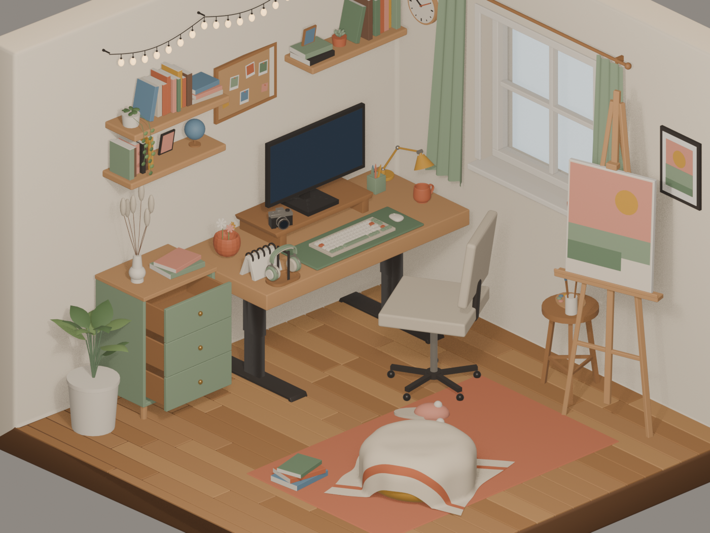

# Study Room

An interactive isometric study room for the web. It reacts to live weather, a motion sensor and (optionally) sound, and has a manual control panel that works without any hardware.



## Original shaders

Two Shadertoy shaders are ported from GLSL to **WGSL**, the way it's done in class: each port is a plain WGSL function in a `.wgsl` file, imported with `?raw`, turned into a node with `wgslFn()` and used as a `MeshBasicNodeMaterial`'s `colorNode`. The Shadertoy inputs (`fragCoord`, `iTime`, `iMouse`, `iResolution`, `iChannel0` + `iChannel0Sampler`) are passed in as TSL `uniform()` nodes.

### Rain on the window

- **Heartfelt** by Martijn Steinrucken (BigWings), 2017 — **https://www.shadertoy.com/view/ltffzl**
- License: [Creative Commons Attribution-NonCommercial-ShareAlike 3.0](https://creativecommons.org/licenses/by-nc-sa/3.0/). The WGSL port in [`web/src/shaders/heartfelt/fragment.wgsl`](web/src/shaders/heartfelt/fragment.wgsl) is shared under the same license. It's hooked up in [`web/src/scene/rain.ts`](web/src/scene/rain.ts).

**What the port keeps:** the hash functions, the drop layers, the static drops, the trails cut through the fog, the three-tap normals, the focus-based blur, the colour shift and the lightning flicker.

**What changed:**
- **Where it runs:** on the window glass instead of full screen.
- **What it refracts:** `iChannel0` is the real scene behind the glass (`viewportMipTexture`), sampled with `textureSampleLevel` for the blur, instead of a fixed texture.
- **Rain amount:** follows the live weather.
- **Lightning:** also flashes the room lights.
- **Interaction:** `iMouse`, exactly like on Shadertoy. Hold and drag on the window: `iMouse.z > 0` while pressed, up and down (`M.y`) sets the amount of rain, and left and right (`M.x`) scrubs the drops through time.
- **Not ported:** the original's heart "story" mode, which isn't used.

### Snow outside the window

- **Snow** — **https://www.shadertoy.com/view/Mdt3Df**
- License: Shadertoy's default, [CC BY-NC-SA 3.0](https://creativecommons.org/licenses/by-nc-sa/3.0/). The WGSL port in [`web/src/shaders/snow/fragment.wgsl`](web/src/shaders/snow/fragment.wgsl) is shared under the same license. It's hooked up in [`web/src/scene/outside.ts`](web/src/scene/outside.ts).

**What the port keeps:** the 6 × 12 nested loops, the per-layer cell sizes, the fall speed and sideways sway, the hashed flake positions and wobble, the 8 % cell occupancy, and the flake falloff.

**What changed:**
- **Where it runs:** drawn on the view outside the window, over the procedural sky. The rain glass then refracts it.
- **Dropped:** the original's own blue gradient and grain.
- **Loop start:** the inner loop starts at `i = 1`, because the original's `i = 0` divides by zero and never draws a flake.
- **Weather:** it only runs when the weather is snowy. Then the hills and roofs turn white, and the glass gets a light fog.

## Layout

```
webgl/
├── blender/                      3D source + pipeline
│   ├── isometricroom.blend          original scene (source of truth, never modified by scripts)
│   ├── isometricroom_enriched.blend generated: props, materials, animations, anchors
│   ├── build_enriched_room.py       original → enriched
│   ├── bake_ao.py                   bakes ambient occlusion → web/public/textures/room_ao.jpg
│   ├── export_glb.py                enriched → web/public/models/study_room.glb
│   ├── render_preview.py            EEVEE look-dev renders → blender/previews/
│   └── SCENE_NOTES.md               every node, anchor, clip and material the website uses
├── web/                          the website (Vite + TypeScript + Three.js WebGPURenderer)
│   ├── public/models/study_room.glb
│   └── src/
│       ├── main.ts                  renderer, camera, loop, click handling
│       ├── config.ts                location, MQTT, timings
│       ├── state/roomState.ts       single RoomState (manual > sensor > live weather)
│       ├── scene/room.ts            GLB loading, node/material lookup, animation clips
│       ├── scene/lighting.ts        sun, sky, lamp, screen, string lights from state
│       ├── shaders/heartfelt/fragment.wgsl  WGSL port of Heartfelt (rain on the glass)
│       ├── shaders/snow/fragment.wgsl       WGSL port of Mdt3Df (snow outside)
│       ├── scene/rain.ts            hooks Heartfelt to the window glass (wgslFn, uniforms, drag = iMouse)
│       ├── scene/outside.ts         procedural view outside the window (+ rain streaks)
│       ├── scene/ambient.ts         mug steam, sunbeam dust, twinkling string lights
│       ├── scene/bakedAO.ts         applies the AO baked in Blender (aoMap on uv1)
│       ├── scene/screen.ts          monitor desktop: code editor, weather, now-playing bar, screensaver
│       ├── scene/interact.ts        hover + click via Blender's `interactive` tags
│       ├── inputs/weather.ts        Open-Meteo polling
│       ├── inputs/sensors.ts        MQTT (ESP32) – only active when configured
│       ├── inputs/music.ts          lo-fi music from the Audius API (headphones)
│       └── ui/panel.ts, ui/toast.ts manual controls + click captions
├── firmware/studyroom_sensor/    ESP32 sketch: PIR motion (+ optional mic) → MQTT
└── NEXT_STEPS.md                 the build guide: what's left and how to do it
```

## Run the website

```bash
cd web
npm install
npm run dev
```

Open http://localhost:5173. The site needs **WebGPU**: recent Chrome or Edge, Safari 26+, or Firefox 141+. The shaders are WGSL, so there's no WebGL fallback. Browsers without WebGPU get a message instead.

- **Configuration (optional):** copy `web/.env.example` to `web/.env.local` and set the weather location and the MQTT broker. Without it, the site uses Lisbon's weather and the manual panel.
- **Production build:** `npm run build` writes `web/dist/`. Upload that folder to any static host (Vercel, Netlify, GitHub Pages).
- **Debugging:** in dev mode, `window.__room` exposes `state`, `room`, `lighting`, `camera` and `controls` in the browser console.

## Update the 3D model

```bash
cd blender
# only to regenerate the enriched file from the original (overwrites manual edits in it):
/Applications/Blender.app/Contents/MacOS/Blender -b isometricroom.blend --factory-startup -P build_enriched_room.py
# after changing the room: re-bake the ambient occlusion, then export
/Applications/Blender.app/Contents/MacOS/Blender -b isometricroom_enriched.blend -P bake_ao.py
/Applications/Blender.app/Contents/MacOS/Blender -b isometricroom_enriched.blend -P export_glb.py
```

The bake takes about a minute on the GPU. The export writes straight into `web/public/models/`. If the dev server is running, just reload the page. Node names stay stable, so the website code keeps working.

## Baking

Ambient occlusion (the soft contact shadows under furniture, in the corners and behind the shelves) is baked in Blender with Cycles, by [`blender/bake_ao.py`](blender/bake_ao.py), into one 2048² atlas: `web/public/textures/room_ao.jpg`.

- **UV map:** each baked object gets a second UV map, `AO_UV`, laid out by hand. The floor, walls, rug and furniture tops are each projected flat into their own region of the atlas. It's exported as glTF `TEXCOORD_1`, which Three.js reads as `uv1`.
- **In Three.js** ([`web/src/scene/bakedAO.ts`](web/src/scene/bakedAO.ts)): the atlas becomes the `aoMap` on UV channel 1, with `flipY = false`, the same as the course's `baked.jpg`.
- **Why only AO:** the course bakes *all* the lighting into one texture shown with an unlit `MeshBasicMaterial`. Here only the occlusion is baked, because the lighting has to stay real-time: it changes with the time of day, the weather, the motion sensor and the desk lamp.
- **What's baked:** only objects that never move. Baked shadows would be wrong on the lamp, drawers, chair, curtains or headphones once they animate.

## Deploy (Netlify)

[`netlify.toml`](netlify.toml) is already set up: it builds from `web/` with `npm run build` and publishes `web/dist`.

1. Go to [app.netlify.com](https://app.netlify.com) → **Add new site** → **Import an existing project** → GitHub, and pick `study-room`.
2. Netlify reads the settings from `netlify.toml`, so just click **Deploy**.
3. Optional: under *Site configuration → Environment variables*, add the `VITE_*` values from `web/.env.example`, then redeploy.

From then on, every push to `main` redeploys the site automatically.

## Sensors

Flash `firmware/studyroom_sensor/studyroom_sensor.ino` to an ESP32. Before you do, copy `secrets.example.h` to `secrets.h` and fill it in. Steps 8–9 of `NEXT_STEPS.md` cover the wiring and setting up the MQTT broker.

## Status

| Piece | State |
|---|---|
| 3D room, materials, animations, anchors | done |
| Scene, camera, lighting by time/weather, motion wake/sleep, clickable objects, manual panel | working starter |
| Live weather (Open-Meteo) | working |
| Rain on glass | done (WGSL port of Heartfelt via wgslFn, refracts the outside view, drag = iMouse) |
| Snow outside | done (WGSL port of Mdt3Df via wgslFn, shown when it snows) |
| Baked ambient occlusion | done (Cycles bake, aoMap on uv1) |
| Ambient animation | done (mug steam, sunbeam dust, twinkling lights, rain streaks outside) |
| Monitor screen | done (live canvas desktop: code + weather) |
| Headphones music | done (Audius trending Lo-Fi, now-playing pill with credit) |
| ESP32 motion + sound | firmware + web client written, not yet tested with hardware |
